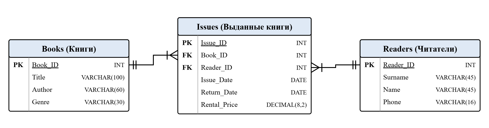

# library-web-app

Практическая работа №2: веб-приложение «Библиотека» — знакомство с Git и GitHub.

Учебный проект веб-приложения для учёта выдачи книг читателям. Этапы разработки проекта ведутся на доске в Kaiten (практическая работа №1).

## Ветви проекта

| Ветвь | Назначение | Файлы |
|-------|------------|-------|
| `main` | Основная ветвь: требования и проектные материалы | requirements.md, library_schema.sql, er_model.png |
| `develop` | Разработка: программный код приложения | app.py, index.html |
| `testing` | Тестирование: тесты и тестовая документация | test_library.py, test_cases.csv, test_queries.sql |

## Структура базы данных

## Команда

С. В. Кобелев, Д. М. Проломова, М. А. Рузанкин, О. А. Хасанова, группа М450, ГУАП, 2026.
